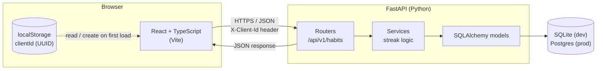

## 1. Requirements
### Functional MVP
* Create, edit and archive a habit (name, optional color or emoji, target frequency: daily or weekly, currently it is set to daily)
* Mark a habit that is done for today or undo it
* See the current streak or longest streak for each habit
* See a history view of the last few weeks, like a GitHub contribution grid
* Each browser get's its own data with no login, through the anonymous ID you chose

### Non Functional
* Streaks must be correct across timezones, "Today" means your today not the server's UTC day
* Marking a habit done must be idempotent, tapping twice doesn't create two checkins
* The API should be clean enough that a React Native app can reuse later

## 2. Architecture


### How the anonymous ID works?:
On the first load the frontend generates a UUID with `crypto.randomUUID`, saves it in localStorage and send it on every request as `X-Client-Id`. The backend scopes every request by that ID.

There is a trade-off; clearing the browser cache or using incognito will lose the data saved. That is okay for MVP now. The schema is designed in a way, if real authentication is implemented, the DB can easily link with the real user / ID.

## 3. Data model
```
clients
  id            UUID  PK        (the browser's anonymous ID)
  created_at    timestamp

habits
  id            int   PK
  client_id     UUID  FK → clients.id
  name          str
  color         str   nullable
  created_at    timestamp
  archived_at   timestamp nullable   (soft delete keeps history)

check_ins
  id            int   PK
  habit_id      int   FK → habits.id
  date          DATE                 (the user's local date, not a timestamp)
  UNIQUE(habit_id, date)             ← enforces idempotency at the DB level
```

**Key Decision**: no column for managing `streak`. Streaks can be computed from check_ins, if we store individual streaks, an undo or missed day streak will leave a stale number.

## 4. API sketch
| Method  | Path | Purpose |
|---|---|---|
|GET|`/habits`|List habits with longest streak and `doneToday`|
|POST|`/habits`|Create a habit|
|PATCH|`/habits/{id}`|Rename, recolor or archive a habit|
|PUT|`/habits/{id}/check-ins/{date}`|Mark done. PUT is idempotent, which fits.|
|DELETE|`/habits/{id}/check-ins/{date}`|Undo|
|GET|`/habits/{id}/check-ins/from=&to=`|History for the grid|
